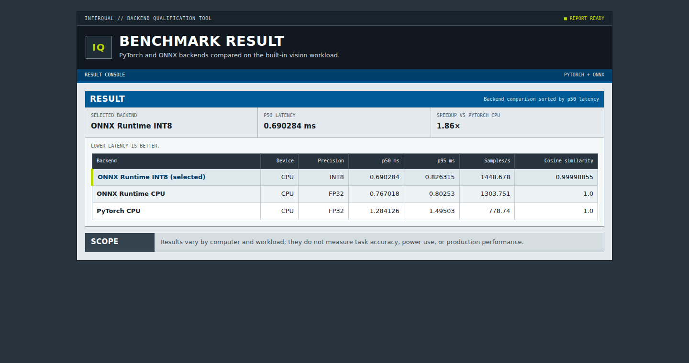

# InferQual

InferQual compares PyTorch, ONNX Runtime, and quantized ONNX on a small built-in vision
workload and reports the selected backend.



## Run

```bash
python -m venv .venv
source .venv/bin/activate
pip install -e .
inferqual run --device cpu
```

The command writes `report.html`, `report.json`, and the exported ONNX models under
`reports/<timestamp>/`. Use `--device auto` to include available CUDA backends.

## Example result

| Selected | Runtime | p50 ms | p95 ms | Samples/s | Cosine similarity |
| --- | --- | ---: | ---: | ---: | ---: |
| yes | ONNX Runtime INT8 | 0.690284 | 0.826315 | 1448.678 | 0.99998855 |
| no | ONNX Runtime FP32 | 0.767018 | 0.802530 | 1303.751 | 1.0 |
| no | PyTorch FP32 | 1.284126 | 1.495030 | 778.740 | 1.0 |

The selected INT8 backend was 1.860× faster at p50 than the PyTorch CPU result.

Results vary by computer and workload; they do not measure task accuracy, power use, or
production performance.

MIT licensed.
